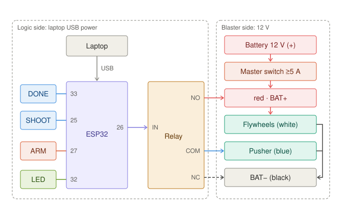

# autobot-act

An SO-101 arm with a blaster plays tic-tac-toe. Claude picks the move; a fine-tuned π0.7 (Physical Intelligence) aims and fires. Built for the act-athon, Sep 25–27, 2026.

Start with [docs/plan.md](docs/plan.md).



## Status

- Pipeline works end to end up to a checkpoint: contract → episodes → training profile → fine-tune (`pi07`). 4 runs succeeded (fake and real SO-101 data).
- **Blocked on inference:** every checkpoint is `available` but has no `gateway_url`; PI needs to enable remote hosting for org `actathon_Ledger`. Details: [docs/notes.md](docs/notes.md).

## Layout

```
autobot/            shared code (schema.py: contract, profile, PI clients)
scripts/            smoke_test.py, watch_hosting.py; record.py / robot_server.py go here
scripts/experiments pipeline tests: mock_pipeline.py, mock_short.py, real_sample.py
firmware/           ESP32 sketch (1 relay, DONE + SHOOT buttons)
data/               recordings, shards, downloads (git-ignored)
runs/               run IDs (*_state.json) and poll logs
docs/               plan, notes/status, concepts, hardware, PI SDK guide
```

## Setup

Credentials stay outside the repo: org API key in `~/.config/pi/api_key` (or `PI_API_KEY`), registry service-account JSON in `~/.config/pi/service-account.json`.

```bash
python3.13 -m venv .venv
.venv/bin/pip install keyring keyrings.google-artifactregistry-auth
GOOGLE_APPLICATION_CREDENTIALS=~/.config/pi/service-account.json .venv/bin/pip install "pi-sdk[video,inference,lerobot]>=0.3.2" \
  --index-url https://us-east5-python.pkg.dev/pi-external-partners/pi-sdk/simple/ --extra-index-url https://pypi.org/simple
.venv/bin/pip install -e .
.venv/bin/python scripts/smoke_test.py
```
