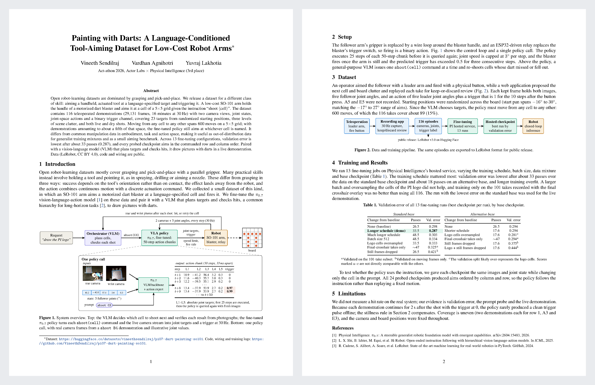
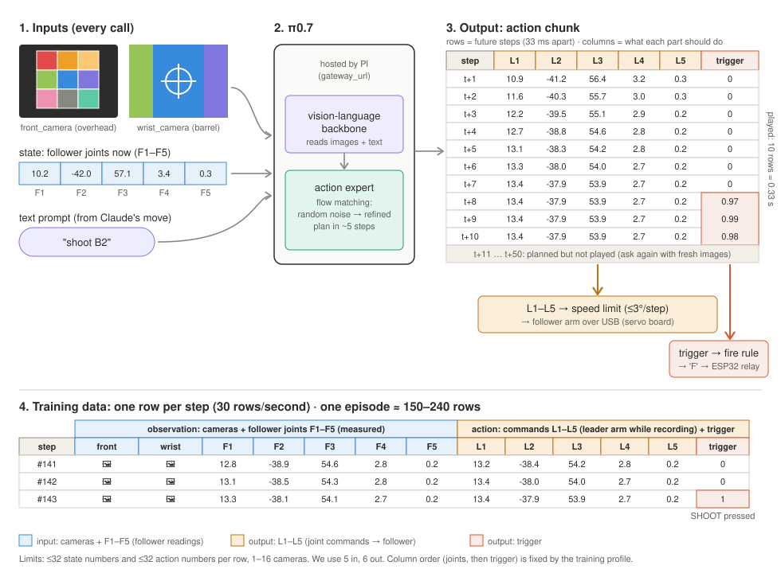
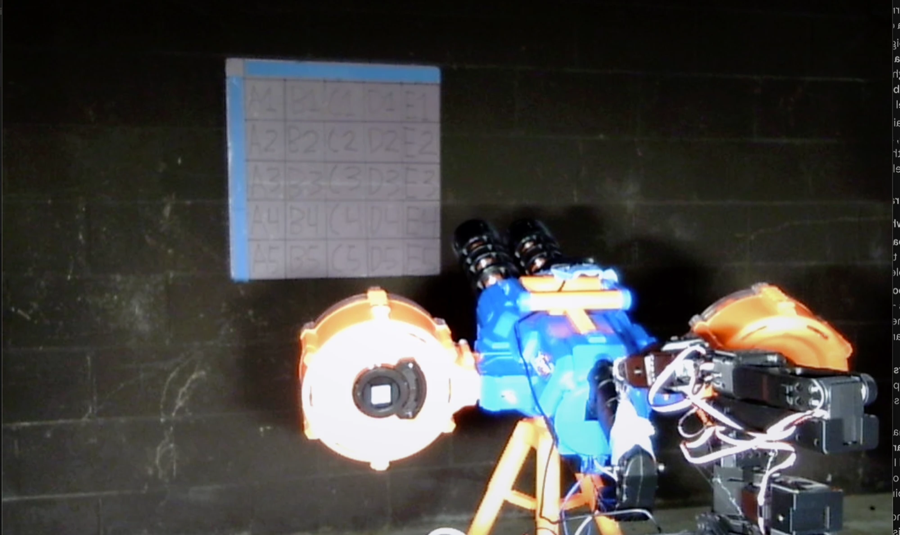
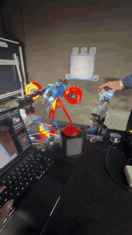
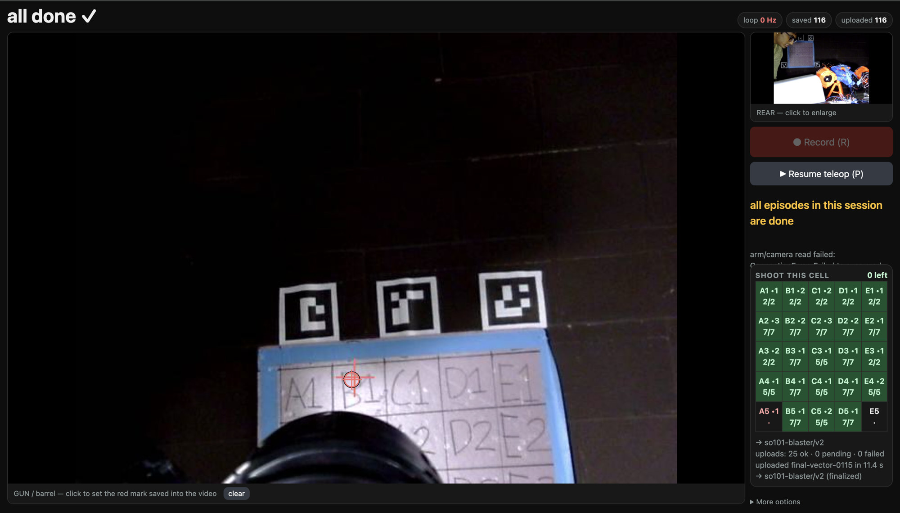

<h1 align="center">Painting with Darts: A Language-Conditioned<br>Tool-Aiming Dataset for Low-Cost Robot Arms</h1>

<p align="center">
<a href="https://x.com/VineethSendil">Vineeth Sendilraj</a> &nbsp;·&nbsp;
<a href="https://x.com/agno_three">Vardhan Agnihotri</a> &nbsp;·&nbsp;
<a href="https://x.com/yuvrajlakh">Yuvraj Lakhotia</a>
<br>
<sub>Act-athon 2026 · Actor Labs × Physical Intelligence · 🥉 3rd place</sub>
</p>

<p align="center">
<a href="docs/report/report.pdf"><b>📄 Paper</b></a> &nbsp;|&nbsp;
<a href="https://huggingface.co/datasets/vineethsendilraj/pi07-dart-painting-so101"><b>🤗 Dataset</b></a> &nbsp;|&nbsp;
<a href="https://x.com/agno_three/status/2105353980377546994"><b>🎥 Demo</b></a> &nbsp;|&nbsp;
<a href="#citation"><b>📎 Cite</b></a>
</p>

<div align="center">
<video src="https://github.com/user-attachments/assets/70205265-8de0-4436-aef0-b8fbe62faa97" width="360" controls muted></video>
</div>

<p align="center">Tell the arm <code>shoot B4</code> and a fine-tuned <b>π0.7</b> aims a motorized dart blaster at that cell and fires.<br>A VLM on top plans the shots to draw pictures.</p>

<p align="center"><a href="docs/report/report.pdf"></a><br><sub>Two-page write-up · click for PDF</sub></p>

## Contents

- [How it works](#how-it-works)
- [Dataset](#dataset)
- [Hardware](#hardware)
- [Data collection](#data-collection)
- [Training results](#training-results)
- [Reproduce](#reproduce)
- [Repository layout](#repository-layout)
- [Citation](#citation)

## How it works



1. **Orchestrator (VLM).** Given a request like `draw the PI logo` and a photo of the board, it picks the next cell and calls `shoot("C3")`. After each shot it looks again and retries any dart that missed or fell off.
2. **VLA policy (π0.7, fine-tuned).** Gets both camera frames, the arm's 5 joint angles and the prompt `shoot C3`. Returns a 50-step plan of joint targets plus a trigger channel.
3. **Execution.** The laptop plays the plan through a speed limit (≤3° per step) and fires once the arm holds still on target and the trigger crosses 0.5.

## Dataset

**116 teleoperated demonstrations** · 29,131 frames at 30 Hz (16 min) · 23 of 25 cells · LeRobot v3.0 · CC BY 4.0

```python
from lerobot.datasets.lerobot_dataset import LeRobotDataset
ds = LeRobotDataset("vineethsendilraj/pi07-dart-painting-so101")
```

| Key | Shape | Contents |
| --- | --- | --- |
| `observation.images.front` | 480×640×3 | rear camera: arm, blaster and board |
| `observation.images.wrist` | 480×640×3 | camera on the blaster, above the barrels |
| `observation.state` | 5 | follower joints (degrees): shoulder_pan, shoulder_lift, elbow_flex, wrist_flex, wrist_roll |
| `action` | 6 | leader joints (degrees) + `trigger` (1 for the 10 steps after the fire button, else 0) |
| task | | `"shoot A1"` … `"shoot E5"` |

`meta/blaster_episodes.jsonl` adds per-episode `live` (23 real shots, 93 dry), `board` clutter (`light` / `heavy` / `late`) and `start` pose.

**Things to know**
- **Post-shot tail:** each take keeps recording 2 s after the shot, with the arm on target and `trigger=0`.
- **Crosshair overlay:** 102 of 116 takes have the recording app's red cross burned into the wrist image; takes 0000–0014 have none or a different mark.
- **Coverage:** A5 and E5 were never recorded; row 1, A3 and E3 have 2 takes each.

The original PI-format MCAP shards are in `data/recordings/final-vector/` (Git LFS). Re-export with `scripts/export_lerobot.py`.

## Hardware



- **Arm:** SO-101 follower with the gripper removed; a wire loop drives the handle of an X-Shot Dartstorm on a tripod. The leader arm is only for teleop.
- **Board:** 5×5 foam grid, A1 (top left) to E5 (bottom right). Darts have thumbtack tips so hits stay put.
- **Cameras:** 640×480 at 30 fps, one behind the blaster (`front`) and one on it (`wrist`).
- **Firing:** an ESP32 drives a relay that replaces the blaster's fire microswitch. A rocker in the battery line is the master switch; off gives dry shots.


More in [docs/hardware.md](docs/hardware.md), including the [stock trigger wiring](docs/img/wiring-blaster-stock.svg). Diagrams are generated by [docs/img/make_wiring_svgs.py](docs/img/make_wiring_svgs.py). The rig ran Yuvraj's `fire_ctl` firmware and `rigd` serial daemon; [firmware/blaster_esp32](firmware/blaster_esp32) is an earlier standalone sketch.

## Data collection

<p><a href="docs/media/teleop.mp4"></a>&nbsp;&nbsp;</p>

`scripts/record_web.py` is the recording app. It proposes the next cell, board clutter and start pose, and overlays a crosshair on the blaster camera. Press **Record**, aim with the leader arm, press the fire button; the take ends 2 s later and a review panel replays it frame by frame (**Good** keeps it, **Bad** deletes it). Guide: [docs/data-collection.md](docs/data-collection.md).

## Training results

13 fine-tunes on PI's hosted service. Full log: [docs/training-runs.md](docs/training-runs.md).

- **Best run:** `full-v2` @ step 3799 (all 116 takes, ~33 passes), validation error **0.287**. Used in the live demo.
- **Schedule matters most:** error bottoms out around 30–35 passes; longer runs and batch 512 did worse.
- **The policy follows the prompt:** with images and joints fixed, all 24 probed checkpoints aim in column and row order as only the cell changes.
- **Firing is the hard part:** the post-shot tail means most on-target frames say "don't fire", so inference uses a stillness-gated fire rule.

## Reproduce

Uploading, training and hosted inference need PI API access (`pi-sdk` is on PI's partner registry). The dataset and LeRobot tooling don't.

```bash
python3.13 -m venv .venv
.venv/bin/pip install keyring keyrings.google-artifactregistry-auth
GOOGLE_APPLICATION_CREDENTIALS=~/.config/pi/service-account.json .venv/bin/pip install "pi-sdk[video,inference,lerobot]>=0.3.2" \
  --index-url https://us-east5-python.pkg.dev/pi-external-partners/pi-sdk/simple/ --extra-index-url https://pypi.org/simple
.venv/bin/pip install -e . 'lerobot[feetech]'
.venv/bin/python scripts/install_calibration.py   # arm calibration → local LeRobot cache
.venv/bin/python scripts/smoke_test.py            # checks the PI key in ~/.config/pi/api_key
```

| Step | Command |
| --- | --- |
| Record | `.venv/bin/python scripts/record_web.py --follower-port … --leader-port … --rigd-url http://localhost:8080` |
| Check | `.venv/bin/python scripts/inspect_episode.py data/recordings/<session>` |
| Upload | `.venv/bin/python scripts/upload.py data/recordings/<session>` |
| Train | `.venv/bin/python scripts/train.py finetune my-run --steps 3800` |
| Run | `.venv/bin/python scripts/robot_server.py --finetune full-v2 --checkpoint-step 3799 --follower-port … --rigd-url … draw "the PI logo"` |

Add `--fake` to `record_web.py` or `robot_server.py` to run without hardware. More: [docs/inference.md](docs/inference.md), [docs/concepts.md](docs/concepts.md).

## Repository layout

```
autobot/                       schema, episode I/O, hardware, policy client, control loop
scripts/                       record, inspect, upload, train, run, export to LeRobot
calibration/                   SO-101 calibration, rest pose, crosshair position
firmware/                      early standalone ESP32 sketch
data/recordings/final-vector/  the 116 episodes (MCAP, Git LFS)
runs/                          fine-tune configs and prompt-probe results
docs/                          hardware, data collection, training log, inference, paper, media
```

## Citation

Code: [MIT](LICENSE) · Dataset: [CC BY 4.0](https://creativecommons.org/licenses/by/4.0/) (use freely, with credit). GitHub's **Cite this repository** button gives the same entry.

```bibtex
@misc{pi07dartpainting2026,
  title        = {pi07-dart-painting-so101: Teleoperated SO-101 Dart-Aiming Demonstrations},
  author       = {Sendilraj, Vineeth and Agnihotri, Vardhan and Lakhotia, Yuvraj},
  year         = {2026},
  howpublished = {\url{https://huggingface.co/datasets/vineethsendilraj/pi07-dart-painting-so101}},
  note         = {Act-athon 2026 (Actor Labs x Physical Intelligence), 3rd place}
}
```

## Acknowledgments

Thanks to [Actor Labs](https://x.com/ActorLabs) and [Physical Intelligence](https://x.com/physical_int) for running the event and for API access, and to [@laneburgett](https://x.com/laneburgett), [@QuanVng](https://x.com/QuanVng) and [@ckkuchi](https://x.com/ckkuchi).
