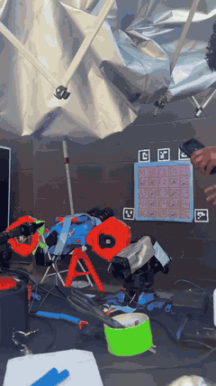

# pi07-dart-painting-so101

<p align="center"><a href="docs/media/demo.mp4"></a></p>

An SO-101 arm aims a motorized dart blaster and draws pictures with darts. It's a two-level system: **Claude is the orchestrator**, planning which cells to shoot and checking the board after each shot, and a fine-tuned **π0.7** VLA ([Physical Intelligence](https://www.physicalintelligence.company/)) is the policy that aims and fires at each cell at 30 Hz.

📄 **Write-up:** [two-page report (PDF)](docs/report/report.pdf)

🥉 **3rd place, Actor Labs × Physical Intelligence Act-athon** (Mountain View, Sep 25–27, 2026). Built by [Vineeth Sendilraj](https://x.com/VineethSendil), [Vardhan Agnihotri](https://x.com/agno_three) and [Yuvraj Lakhotia](https://x.com/yuvrajlakh). Demo video and write-up: [thread on X](https://x.com/agno_three/status/2105353980377546994).

**Dataset:** the 116 teleop demos we trained on are open in LeRobot format: [🤗 vineethsendilraj/pi07-dart-painting-so101](https://huggingface.co/datasets/vineethsendilraj/pi07-dart-painting-so101). See [Dataset](#dataset).

## How it works


1. **Orchestrator.** A prompt like `draw the PI logo` and a snapshot of the board go to Claude. Claude picks the next cell and calls `shoot("C3")`. It looks again after each shot and retries any dart that missed or fell off.
2. **VLA policy.** π0.7 gets both camera frames, the arm's 5 joint angles and the prompt `shoot C3`. It returns a 50-step plan of joint targets plus a trigger channel.
3. The laptop plays the plan through a speed limit (≤3° per step). It fires once the arm holds still on target and the trigger crosses the threshold.

## Rig


- **Arm:** SO-101 follower (Feetech STS3215 servos, no gripper). It drives the handle of an X-Shot Dartstorm on a tripod through a wire loop. The leader arm is used only for teleop.
- **Board:** 5×5 foam grid, A1 (top left) to E5 (bottom right). The darts have thumbtack tips, so hits stay in the board.
- **Cameras (640×480, 30 fps):** `front_camera` sits behind the blaster and sees the arm, blaster and whole board. `wrist_camera` rides on the blaster above the barrels.
- **Firing:** an ESP32 (GPIO13) drives a relay that replaces the blaster's fire microswitch. An operator button on GPIO25 fires during teleop and records the trigger label. A rocker in the battery line is the master switch: off means dry shots (the relay clicks, nothing fires).


Details: [docs/hardware.md](docs/hardware.md) covers the arm, how teleop works and the blaster wiring. It includes the [stock trigger wiring](docs/img/wiring-blaster-stock.svg) we reverse-engineered first. The diagrams are generated by [docs/img/make_wiring_svgs.py](docs/img/make_wiring_svgs.py).

The ESP32 on the rig ran Yuvraj's `fire_ctl` 1.3.0 firmware and `rigd` serial daemon (`--rigd-url`). [firmware/blaster_esp32](firmware/blaster_esp32) is an earlier standalone sketch with the same relay idea, but it wasn't used on the rig.

## Teleop and recording

<p><a href="docs/media/teleop.mp4"></a>&nbsp;&nbsp;</p>

`scripts/record_web.py` (http://127.0.0.1:7870) is the recording app. It shows which cell to aim at next and how to set up the board (clutter level, live or dry shot, start pose). It also overlays a crosshair on the gun camera.

You press **Record**, aim with the leader arm and press the physical fire button. The take ends 2 s later. A review panel plays both cameras and the joint table frame by frame: **Good** keeps it and **Bad** deletes it. Full guide: [docs/data-collection.md](docs/data-collection.md).

## Dataset

116 episodes (29,000+ frames, ~16 min) of `shoot <cell>` demos, all marked good at review. Available two ways:

| Format | Where |
| --- | --- |
| **LeRobot v3.0** (parquet + AV1 mp4) | [🤗 vineethsendilraj/pi07-dart-painting-so101](https://huggingface.co/datasets/vineethsendilraj/pi07-dart-painting-so101) |
| PI MCAP shards (what we trained on) | `data/recordings/final-vector/` in this repo (Git LFS) |

```python
from lerobot.datasets.lerobot_dataset import LeRobotDataset
ds = LeRobotDataset("vineethsendilraj/pi07-dart-painting-so101")
```

| Key | Shape | Contents |
| --- | --- | --- |
| `observation.images.front` | 480×640×3 | rear camera: arm, blaster and board |
| `observation.images.wrist` | 480×640×3 | gun camera, above the barrels |
| `observation.state` | 5 | follower joints (degrees): shoulder_pan, shoulder_lift, elbow_flex, wrist_flex, wrist_roll |
| `action` | 6 | leader joints (degrees) + `trigger` (1 for the 10 steps after the fire button, else 0) |
| task | | `"shoot A1"` … `"shoot E5"` |

`meta/blaster_episodes.jsonl` adds the following for each episode:
- `live`: 23 takes fired a real dart. The other 93 were dry (master switch off, same motion).
- `board`: clutter level (`light` / `heavy` / `late`).
- `start`: the start pose (rest, or aimed at another cell).

Things to know:
- **Post-shot tail.** Each take keeps recording 2 s after the shot, with the arm still on target and `trigger=0`.
- **Crosshair overlay.** 102 of the 116 takes have the recording app's red crosshair burned into the wrist image. The earliest takes (0000–0014) have no mark or a different one.
- **Missing cells.** A5 and E5 were never recorded. Row 1, A3 and E3 have only 2 takes each.

Re-export from the MCAP shards: `.venv/bin/python scripts/export_lerobot.py data/recordings/final-vector --repo-id <you>/<name>`.

## Training

We fine-tuned π0.7 through PI's hosted fine-tuning API. The run log is [docs/training-runs.md](docs/training-runs.md): 13 runs, validation error, prompt probes and firing checks.
- **The model listens to the prompt.** All 24 probed checkpoints aim in column and row order when only the cell in the prompt changes.
- **Best run:** `full-v2` @ step 3799 (all 116 takes, ~33 passes), with validation error 0.287. More passes overfit, and so did batch 512.
- **Firing was the hard part.** The 2 s post-shot tail means only about a third of the on-target frames say "fire". The fix at inference is a fire rule: fire once the arm is still on target.

## Setup

`pi-sdk` comes from PI's partner registry, so you need PI API access to upload, train or run hosted checkpoints. The dataset and LeRobot tooling don't need it.

```bash
python3.13 -m venv .venv
.venv/bin/pip install keyring keyrings.google-artifactregistry-auth
GOOGLE_APPLICATION_CREDENTIALS=~/.config/pi/service-account.json .venv/bin/pip install "pi-sdk[video,inference,lerobot]>=0.3.2" \
  --index-url https://us-east5-python.pkg.dev/pi-external-partners/pi-sdk/simple/ --extra-index-url https://pypi.org/simple
.venv/bin/pip install -e . 'lerobot[feetech]'
.venv/bin/python scripts/install_calibration.py   # this pair of arms → local LeRobot cache
.venv/bin/python scripts/smoke_test.py            # all OK = PI key works (~/.config/pi/api_key)
```

```bash
caffeinate -i .venv/bin/python scripts/record_web.py --follower-port … --leader-port … --rigd-url http://localhost:8080 --auto-upload
.venv/bin/python scripts/inspect_episode.py data/recordings/<session>     # contract, Hz, gaps, trigger block
.venv/bin/python scripts/upload.py data/recordings/<session>
.venv/bin/python scripts/train.py finetune my-run --steps 3800 && .venv/bin/python scripts/train.py watch my-run
.venv/bin/python scripts/robot_server.py --finetune full-v2 --checkpoint-step 3799 --follower-port … --rigd-url … draw "the PI logo"
```
Add `--fake` to `record_web.py` or `robot_server.py` to run without hardware. Inference details: [docs/inference.md](docs/inference.md). How π0.7 and PI's data format work: [docs/concepts.md](docs/concepts.md).

## Layout

```
autobot/      schema (topics, contract, training profile), episode I/O, hardware, policy client, control loop
scripts/      record_web · inspect_episode · upload · train · robot_server · draw_web · export_lerobot · …
calibration/  SO-101 leader/follower calibration, rest pose, gun crosshair position
firmware/     early standalone ESP32 sketch (the rig ran fire_ctl, see Rig)
data/recordings/final-vector/  the 116 episodes (MCAP, Git LFS)
runs/         fine-tune configs and prompt-probe results
docs/         hardware, data collection, training runs, inference, concepts; report/ (LaTeX write-up), media/ (videos)
```

## Citation

The code is [MIT](LICENSE). The dataset is [CC BY 4.0](https://creativecommons.org/licenses/by/4.0/): use it freely, with credit. GitHub's **Cite this repository** button gives the same entry. If you use it in a paper:

```bibtex
@misc{pi07dartpainting2026,
  title        = {pi07-dart-painting-so101: Teleoperated SO-101 Dart-Aiming Demonstrations},
  author       = {Sendilraj, Vineeth and Agnihotri, Vardhan and Lakhotia, Yuvraj},
  year         = {2026},
  howpublished = {\url{https://huggingface.co/datasets/vineethsendilraj/pi07-dart-painting-so101}},
  note         = {Act-athon 2026 (Actor Labs x Physical Intelligence), 3rd place}
}
```

## Thanks

Thanks to [Actor Labs](https://x.com/ActorLabs) and [Physical Intelligence](https://x.com/physical_int) for running the event and for API access. Special thanks to [@laneburgett](https://x.com/laneburgett), [@QuanVng](https://x.com/QuanVng) and [@ckkuchi](https://x.com/ckkuchi).
