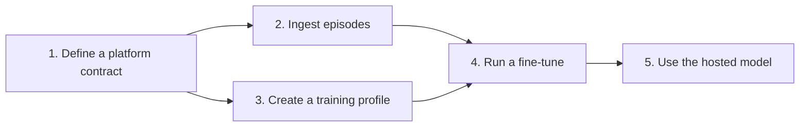

# Self-serve API: end-to-end guide (Preview)

> Source: PI Notion page "Self-serve API end-to-end guide (Preview)"
> https://www.notion.so/Self-serve-API-end-to-end-guide-Preview-3e50d8d430d48158ac39ce119dfe9fb2
> Copied from the version pasted on 2026-09-25 (the Notion page itself needs a login). Re-check the page for updates.

> **Preview.** This guide creates real platform contracts, episodes, fine-tunes, and hosted models in your organization. Request and response formats may change during the preview.

This guide shows you how to take your own robot from recorded data to a hosted, fine-tuned Physical Intelligence (PI) model. You use only the `pi-sdk` Python client and the Partner APIs.

In this guide, you do the following:

1. **Define a platform contract** that describes the data your robot records.
2. **Ingest episodes** that follow the contract.
3. **Create a training profile** that maps the contract's topics to model inputs and outputs.
4. **Run a fine-tune** on the ingested episodes.
5. **Use the hosted model** for remote inference.

The examples use a bimanual robot: two arms, each with six joints and a parallel gripper, recorded at 30 Hz with one top camera and two wrist cameras. Replace the topic names, dimensions, and rates with your robot's values.



# Key concepts

| Resource | What it is |
| --- | --- |
| **Platform contract** | An immutable description of the MCAP topics your robot records: each topic's role, wire schema, expected frequency, and array shape and data type. Every episode references one platform contract. |
| **Episode** | One recording, identified by your own episode ID. An episode consists of one or more MCAP shards plus metadata and annotations. |
| **Training profile** | An immutable mapping from a platform contract's topics to ordered camera, state, and action model inputs and outputs. |
| **Dataset filter** | An immutable, named query that selects ingested episodes for training. |
| **Fine-tune** | One training run from a PI base model, using one or more dataset filters and a training profile. |
| **Checkpoint** | A model artifact produced by a fine-tune. When remote hosting is enabled, PI serves the checkpoint through the model gateway. |

All resources are scoped to your organization. Names for training profiles, dataset filters, and fine-tunes must be unique lowercase kebab-case within your organization.

# Before you begin

Make sure that you have the following:

- **An organization API key.** Create or rotate a key in the Partner Portal at partner.pi-fleet.com. The key authenticates every API call and is scoped to your organization.
- **A registry key.** PI provides a service-account key file during onboarding. It authenticates package installation from PI's Python registry and is separate from your organization API key.
- **Fine-tuning enabled for your organization.** PI enables the base models that your organization can use and whether checkpoints are hosted remotely. If you don't know which base model IDs are enabled for your organization, contact your PI representative.
- **Python 3.11 or later.**

## Install the SDK

Install `pi-sdk` 0.3.2 or later with the `video` and `inference` extras. The `video` extra encodes camera frames for MCAP shards, and the `inference` extra runs remote inference.

```bash
pip install keyring keyrings.google-artifactregistry-auth
export GOOGLE_APPLICATION_CREDENTIALS=/path/to/pi-sa-key.json
pip install "pi-sdk[video,inference]>=0.3.2" \
  --index-url https://us-east5-python.pkg.dev/pi-external-partners/pi-sdk/simple/ \
  --extra-index-url https://pypi.org/simple
```

Using uv? Pass PI's registry with `--extra-index-url` instead of `--index-url`. uv checks extra indexes first and uses only the first index that has `pi-sdk`.

## Set your API key

```bash
export PI_API_KEY=<partner-portal-api-key>
```

The examples read the key from `PI_API_KEY`. The SDK sends the key in an authorization header. It never places the key in a URL or a log. Don't commit the key to source control.

```python
import os

import pi_sdk

data_client = pi_sdk.data.Client(api_key=os.environ["PI_API_KEY"])
finetuning_client = pi_sdk.finetuning.Client(api_key=os.environ["PI_API_KEY"])
```

The data client uses `https://api.pi-fleet.com/v1/data` and the fine-tuning client uses `https://api.pi-fleet.com/v1/finetuning` by default. Both clients retry transient errors for operations that are safe to repeat.

# Step 1: Define a platform contract

A platform contract tells PI exactly what your MCAP files contain. The service validates every episode against its contract when you finalize the upload.

## Describe your topics

An `McapContract` is a list of topic contracts. Each topic declares the following fields:

| Field | Meaning |
| --- | --- |
| `topic` | The exact topic name in your MCAP files, such as `observation/left_arm/joints/position`. |
| `role` | `system`, `observation`, or `action`. |
| `schema_encoding` | Use `protobuf` for PI data types. |
| `schema_name` | The public schema name: `pi.data.v1.SnapshotRef` for `system/step`, `pi.data.v1.NdArray` for arrays, or `pi.data.v1.VideoFrame` for cameras. |
| `expected_frequency_hz` | The expected publish rate. Use `0` when no frequency requirement applies. |
| `frequency_tolerance` | The relative tolerance around the expected frequency. For example, `0.1` means ±10%. |
| `ndarray` | Optional exact shape and data type for an `NdArray` topic. |
| `required_in_snapshots` | Snapshot topics that must reference this topic in every step, usually `system/step`. |

A valid contract has the following:

- Exactly one `system/step` topic, with schema `pi.data.v1.SnapshotRef` and a positive expected frequency. `system/step` defines the robot's control rate. For fine-tuning, use a whole number of hertz, such as `30`.
- At least one observation topic, and at least one observation or action topic that is required in `system/step`.
- A unique name, schema encoding, and schema name for every topic.
- A frequency tolerance whenever an expected frequency is set.

To train on a topic later, declare it with the following constraints:

- **Cameras:** observation topics with schema `pi.data.v1.VideoFrame`.
- **State and actions:** one-dimensional `pi.data.v1.NdArray` topics with an explicit shape and data type. State topics use the `observation` role, and action topics use the `action` role.

## Create the contract

The following example defines the bimanual robot:

```python
from pi_sdk.data import McapContract, NdArrayContract, TopicContract

FPS = 30
ARMS = ("left_arm", "right_arm")
CAMERAS = ("top_camera", "left_wrist_camera", "right_wrist_camera")

def array_topic(topic: str, shape: tuple[int, ...], *, role: str) -> TopicContract:
    return TopicContract(
        topic=topic,
        role=role,
        schema_encoding="protobuf",
        schema_name="pi.data.v1.NdArray",
        expected_frequency_hz=0,
        frequency_tolerance=0,
        ndarray=NdArrayContract(shape=shape, dtype="float32"),
        required_in_snapshots=("system/step",),
    )

def camera_topic(topic: str) -> TopicContract:
    return TopicContract(
        topic=topic,
        role="observation",
        schema_encoding="protobuf",
        schema_name="pi.data.v1.VideoFrame",
        expected_frequency_hz=0,
        frequency_tolerance=0,
        required_in_snapshots=("system/step",),
    )

topics = [
    TopicContract(
        topic="system/step",
        role="system",
        schema_encoding="protobuf",
        schema_name="pi.data.v1.SnapshotRef",
        expected_frequency_hz=FPS,
        frequency_tolerance=0.1,
    ),
]
for arm in ARMS:
    topics.append(array_topic(f"observation/{arm}/joints/position", (6,), role="observation"))
    topics.append(array_topic(f"observation/{arm}/gripper/position", (1,), role="observation"))
for camera in CAMERAS:
    topics.append(camera_topic(f"observation/{camera}/rgb/image"))
for arm in ARMS:
    topics.append(array_topic(f"action/{arm}/joints/position", (6,), role="action"))
    topics.append(array_topic(f"action/{arm}/gripper/position", (1,), role="action"))

result = data_client.ensure_platform_contract(
    "example_biarm_v1",
    McapContract(topics=tuple(topics)),
    description="Two 6-DoF arms with grippers, one top camera, and two wrist cameras at 30 Hz",
)
platform_contract_id = result.platform_contract.platform_contract_id
```

Save `platform_contract_id` with your uploader configuration. You use it in every later step.

`ensure_platform_contract` is idempotent: if an equivalent contract already exists in your organization, the call returns it with `newly_created=False` instead of creating a duplicate. Topic order doesn't affect equivalence, and the name and description don't determine identity.

> **Platform contracts are immutable.** You can update a contract's name, description, and lifecycle (`active`, `inactive`, or `deprecated`) with `update_platform_contract`, but not its topics. When your recording format changes, create a new contract and use its ID for new episodes.

# Step 2: Ingest episodes

Each episode is uploaded as one or more PI-native MCAP shards. You write the shards locally, register the episode, upload the shards, and then finalize the episode.

> **Already have LeRobot v3 data?** The `pi-upload-lerobot` command converts LeRobot episodes into PI-native shards and uploads them. Install `pi-sdk[lerobot]`, map each LeRobot feature to a contract topic, and run `pi-upload-lerobot --help` for the available options. The other steps in this guide stay the same.

## Choose stable identities

Before you write any files, choose the following values:

- **Episode ID:** a unique, stable ID for each recording, such as `station-1-run-0042`. Retrying with the same episode ID is safe; changed recordings need a new episode ID.
- **Source dataset path:** a stable name for the logical collection, such as `biarm-demos/v1`. Every episode in the collection uses the same value. You can select a collection by this value in step 4.
- **Recording window:** the absolute UTC start and end of the recording, aligned to microsecond precision. The end is exclusive, so set it after the last recorded message.

## Write the MCAP shards

For efficient, retryable uploads, write one light shard for the arrays and `system/step`, and one shard for each camera. `v1.Writer` checks every message against your contract as you write it.

Each robot step writes the state and action arrays, encodes each camera image, and then writes a `system/step` snapshot that references every topic in that step. `v1.VideoEncoder` encodes `uint8` RGB images with shape `(height, width, 3)` as H.264 frames without B-frames. Width and height must be even and must stay the same within an episode.

```python
from pathlib import Path

from pi_sdk.mcap import v1

contract = data_client.get_platform_contract(platform_contract_id)

def write_shards(steps, output_dir: Path) -> list[Path]:
    """Write one light shard and one shard per camera for one episode.

    Each step provides time_ns (int), images (camera -> uint8 RGB array),
    and arrays (topic -> float32 array) for every state and action topic.
    """
    light_path = output_dir / "light.mcap"
    camera_paths = {camera: output_dir / f"{camera}.mcap" for camera in CAMERAS}
    light = v1.Writer(light_path, contract=contract)
    camera_writers = {camera: v1.Writer(path, contract=contract) for camera, path in camera_paths.items()}
    encoders = {camera: v1.VideoEncoder(fps=FPS) for camera in CAMERAS}

    for sequence_id, step in enumerate(steps):
        fields = []
        for camera in CAMERAS:
            topic = f"observation/{camera}/rgb/image"
            for frame in encoders[camera].encode(
                step.images[camera], capture_time_ns=step.time_ns, sequence_id=sequence_id
            ):
                camera_writers[camera].write_video_frame(topic, frame)
            fields.append(v1.FieldRef(topic=topic, sequence_id=sequence_id, capture_time_ns=step.time_ns))
        for topic, value in step.arrays.items():
            fields.append(
                light.write_ndarray(topic, value, capture_time_ns=step.time_ns, sequence_id=sequence_id)
            )
        light.write_step(fields, capture_time_ns=step.time_ns, sequence_id=sequence_id)

    for camera in CAMERAS:
        for frame in encoders[camera].finalize():
            camera_writers[camera].write_video_frame(f"observation/{camera}/rgb/image", frame)
    for writer in (light, *camera_writers.values()):
        writer.close()
    return [light_path, *camera_paths.values()]
```

The encoder can return a frame after it receives later images. Each returned frame keeps the `sequence_id` and `capture_time_ns` that you passed with its source image, so build the step's camera `FieldRef` from those values, as the example does. Call `finalize` after the last image to write the remaining frames.

In the action arrays, record the command that the robot executed at that step. For absolute control, that's the target position for each joint and gripper.

## Register, upload, and finalize the episode

Create the episode with its metadata and initial annotations, upload each shard, and then finalize the episode:

```python
from datetime import UTC, datetime

from pi_sdk.data import EpisodeDeclaration, EpisodeMetadata, EpisodeShard, control_source, language_segment

episode_id = "station-1-run-0042"
start = datetime(2026, 9, 24, 12, 0, 0, tzinfo=UTC)
end = datetime(2026, 9, 24, 12, 0, 30, tzinfo=UTC)
handover = datetime(2026, 9, 24, 12, 0, 14, tzinfo=UTC)
task = "hand the cube from the left gripper to the right gripper"

data_client.create_episode(
    EpisodeDeclaration(
        episode_id=episode_id,
        robot_id="station-1",
        robot_platform="example_biarm_v1",
        recording_start_time=start,
        recording_end_time=end,
    ),
    EpisodeMetadata(
        dataset="biarm-demos",
        task=task,
        is_eval_episode=False,
        success=True,
        source_dataset_path="biarm-demos/v1",
    ),
    platform_contract_id=platform_contract_id,
    spans=[
        control_source(start=start, end=end, value="human"),
        language_segment(start=start, end=handover, task=task, subtask="pick up the cube with the left gripper"),
        language_segment(start=handover, end=end, task=task, subtask="pass the cube to the right gripper"),
    ],
)

for path in write_shards(steps, Path("shards") / episode_id):
    shard = EpisodeShard.create(
        path, episode_id=episode_id, recording_start_time=start, recording_end_time=end
    )
    data_client.upload_shard(episode_id, shard)

data_client.finalize_episode_upload(episode_id)
if data_client.get_episode(episode_id).upload_completed_at is None:
    raise RuntimeError(f"episode {episode_id} did not finalize")
```

Keep the following in mind:

- **Annotations are optional but useful.** A `language_segment` with a `subtask` becomes the model's subtask instruction for the steps it covers, and the episode task remains the overall instruction. Put the subtask instruction in `subtask`; a span's `task` and `text` aren't used as subtask instructions. A `control_source` span marks who controlled the robot. Span times must fall within the recording window.
- **Finalization validates the whole episode** against the contract: topics, schemas, frequencies, array shapes, data types, and `system/step` references. An episode is ready for training only after `upload_completed_at` is set.
- **Retries are safe.** `EpisodeShard.create` derives a stable shard ID from the episode, recording window, and file contents, and the upload and finalize calls are idempotent. Don't modify a shard file after you create its `EpisodeShard`.
- **If your organization has a Partner Data Contract,** pass its required `collection/location/*` attributes in the `attributes` argument of `create_episode`.

# Step 3: Create a training profile

A training profile tells the fine-tuning service which contract topics feed the model and in what order. A fine-tune on episodes that use your own platform contract requires a training profile.

## Choose the model inputs and outputs

| Field | Meaning |
| --- | --- |
| `base_camera_topics` | Ordered cameras that observe the scene, such as a top or head camera. |
| `wrist_camera_topics` | Ordered cameras mounted on the arms. |
| `state_slices` | Ordered ranges of one-dimensional observation arrays. `end_index` is exclusive; leave it unset to select through the end of the array. |
| `action_topics` | Ordered, complete one-dimensional action arrays. |
| `action_space` | `absolute` (the default) or `delta`. With `delta`, the model predicts the action minus the current state. |
| `keep_idle_actions` | When `False` (the default), training skips idle stretches where the robot doesn't move. |

The service validates the profile against the contract:

- You select from 1 through 16 unique camera topics.
- You select from 1 through 32 state slices and from 1 through 32 unique action topics.
- The total state width and the total action width are each at most 32 values.
- Action topics are complete; partial action slices aren't supported.
- A `delta` profile uses exactly one state slice and one action topic, with equal widths.

The state slices and the action topics are each concatenated in profile order. At inference, the hosted model splits its predicted action vector back into your original action topics.

## Create the profile

The following profile uses the top camera as the base camera, both wrist cameras, 14 state values, and 14 absolute actions:

```python
from pi_sdk.finetuning import ArraySlice, TrainingProfileConfig

PARTS = ("joints", "gripper")

profile = finetuning_client.create_training_profile(
    "example-biarm-training-v1",
    platform_contract_id,
    TrainingProfileConfig(
        base_camera_topics=("observation/top_camera/rgb/image",),
        wrist_camera_topics=(
            "observation/left_wrist_camera/rgb/image",
            "observation/right_wrist_camera/rgb/image",
        ),
        state_slices=tuple(ArraySlice(f"observation/{arm}/{part}/position") for arm in ARMS for part in PARTS),
        action_topics=tuple(f"action/{arm}/{part}/position" for arm in ARMS for part in PARTS),
        action_space="absolute",
    ),
)
print(profile.training_profile_id, profile.profile.state_slices)
```

The returned profile shows each state slice's resolved `end_index`. Use `get_training_profile` and `list_training_profiles` to read saved profiles, and `delete_training_profile` to delete a profile that no fine-tune uses.

> **Training profiles are immutable.** To change the topic mapping, create a new profile. Inference settings, such as `num_denoising_steps`, aren't part of the profile; set them in `sample_args` when you run inference.

# Step 4: Run a fine-tune

## Select the training data

Create a dataset filter that selects episodes to include in training runs. `platform_contract_id` selects episodes ingested with exactly that contract, and `source_dataset_path` narrows the selection to one collection:

```python
from pi_sdk.finetuning import EpisodeFilter

dataset_filter = finetuning_client.create_dataset_filter(
    "example-biarm-v1-successes",
    EpisodeFilter(
        platform_contract_id=platform_contract_id,
        source_dataset_path="biarm-demos/v1",
        success=True,
    ),
)
```

Other filter fields include `episode_ids`, `tasks`, `min_episode_steps` and `max_episode_steps`, `attributes`, and recording and ingestion time ranges. Set `dagger_data_filter=True` to keep only human-controlled steps. Omit a field to leave that dimension unfiltered.

Like training profiles, dataset filters are immutable. Repeating an identical request returns the existing filter, and reusing a name with a different query fails.

## How span annotations affect training

Fine-tuning samples a robot step together with the action chunk that follows it. Episode and span annotations determine the instructions attached to that sample and, optionally, which steps are eligible for training:

- The episode's `task` is the overall instruction.
- When a step falls within a `language_segment` that has a `subtask`, the model uses that `subtask` as the step-level instruction. At steps without a subtask span, training falls back to the episode task. A span's `task` and `text` aren't used as subtask instructions.
- A `control_source` span doesn't filter training data by itself. With `dagger_data_filter=True`, only steps covered by `human` control spans are kept, and action chunks stop at the end of those spans.

Span timestamps are mapped to the episode's robot steps. For predictable instruction boundaries, use non-overlapping `language_segment` spans and place each boundary at the transition between subtasks.

Dataset filters don't reference individual span IDs. To select steps by a span annotation, add an `AttributePredicate` with `scope="span"`. For example, the following filter selects steps covered by spans where `control_source` is `human`:

```python
from pi_sdk.finetuning import AttributePredicate, EpisodeFilter

human_only_filter = finetuning_client.create_dataset_filter(
    "example-biarm-v1-human-steps",
    EpisodeFilter(
        platform_contract_id=platform_contract_id,
        source_dataset_path="biarm-demos/v1",
        success=True,
        attributes=(
            AttributePredicate(
                name="control_source",
                operation="equals",
                value="human",
                scope="span",
            ),
        ),
    ),
)
```

Span-scoped attribute predicates are the generic mechanism for matching span annotations. `dagger_data_filter=True` is shorthand for the `control_source == "human"` predicate above. Language spans that remain after filtering supply the subtask instruction for the steps they cover.

By default, an action chunk that begins in a language span can include actions after that span ends. Use the following option when actions from the next subtask shouldn't be included in the same training sample.

### Truncate actions at span ends

By default, a training action chunk can continue past the end of the span that contains it, such as a labeled subtask. To end each action chunk at the end of its span, set `truncate_actions_at_span_end=True` when you create the dataset filter:

```python
truncated_filter = finetuning_client.create_dataset_filter(
    "example-biarm-v1-successes-truncated",
    EpisodeFilter(
        platform_contract_id=platform_contract_id,
        source_dataset_path="biarm-demos/v1",
        success=True,
    ),
    truncate_actions_at_span_end=True,
)
```

The setting is stored with the dataset filter. To compare both behaviors on the same episodes, create one dataset filter with the setting on and one with it off.

Dataset filters that keep only human-controlled steps (`dagger_data_filter=True`) always end action chunks at the end of the human-controlled span, so training doesn't use policy-controlled steps after an intervention.

## Start the fine-tune

The following example fine-tunes `pi07_cosmic` for 1,000 steps and keeps only the final checkpoint:

```python
from pi_sdk.finetuning import CheckpointPolicy, DatasetFilterInput

finetune = finetuning_client.create_finetune(
    "example-biarm-ft-v1",
    [DatasetFilterInput(dataset_filter.dataset_filter_id)],
    base_model="pi07_cosmic",
    num_steps=1_000,
    batch_size=256,
    checkpoint_policy=CheckpointPolicy("final_only"),
    training_profile_id=profile.training_profile_id,
)
run_id = finetune.run_id
```

| Argument | Use |
| --- | --- |
| `name` | Required. Unique lowercase kebab-case name. |
| `dataset_filters` | Required. One to 100 filters. Without weights, data is sampled in proportion to each filter's size; to set explicit shares, give every filter a positive `weight`. |
| `base_model` | A PI base model ID enabled for your organization, such as `pi07_cosmic` or `pi07`. |
| `continue_from_checkpoint_id` | Use instead of `base_model` to continue training from one of your available checkpoints. The new fine-tune keeps the source fine-tune's platform contract and training profile. |
| `training_profile_id` | Required when the selected episodes use a platform contract that you created. The profile must reference the same contract as the selected episodes. |
| `num_steps` | Optional. If omitted, the service starts from the default run length of 20,001 optimizer steps and reduces it when necessary so the run does not exceed the maximum allowed passes over the selected data. |
| `batch_size` | Optional. `256`, `512`, `1024`, `2048`, or `4096`. Omit it to use the base model's recommendation. |
| `checkpoint_policy` | Optional. Omit it to keep only the final checkpoint. To keep checkpoints periodically, use `CheckpointPolicy("every_n_steps", every_n_steps=..., limit=...)`. `limit` is the maximum number of checkpoints to keep and cannot exceed 3. |

All selected episodes must be finalized and use the same platform contract, and the base model must support that contract. Create calls are idempotent: an identical retry returns the existing fine-tune, and reusing a name with different inputs fails with the existing fine-tune's `run_id` in the error detail.

> **Tip:** Each fine-tune is limited to a maximum number of passes over the selected data. For a short test fine-tune, ingest at least a few thousand steps of data, or reduce `num_steps`.

## Monitor the fine-tune

Poll the fine-tune until it reaches a terminal state:

```python
import time

while finetune.state in {"pending", "running"}:
    time.sleep(60)
    finetune = finetuning_client.get_finetune(run_id)
    if finetune.progress is not None:
        print(f"{finetune.state}: {finetune.progress:.0%}")

if finetune.state != "succeeded":
    raise RuntimeError(finetune.terminal_reason or finetune.state)
```

| State | Meaning |
| --- | --- |
| `pending` | Accepted and queued. |
| `running` | Preparing data or training. `progress` reports the fraction of planned steps completed after the training job logs its first step. |
| `succeeded` | Training completed. |
| `failed` | The fine-tune stopped. `terminal_reason` describes the failure and includes an error ID to share with PI. |
| `cancelled` | The fine-tune was cancelled before completion. |

To follow action prediction error during training, call `list_finetune_evaluations`:

```python
for metrics in finetuning_client.list_finetune_evaluations(run_id):
    print(metrics.step, metrics.train_mae, metrics.validation_mae)
```

These metrics measure how closely the model predicts the recorded actions. They don't measure closed-loop task success on the robot.

To stop a fine-tune, call `finetuning_client.cancel_finetune(run_id)`. Cancellation is safe to retry.

# Step 5: Use the hosted model

## Wait for the hosted checkpoint

After the fine-tune succeeds, PI verifies each selected checkpoint and, when remote hosting is enabled for your organization, deploys it behind the model gateway. A checkpoint is ready for inference when its state is `available` and it has a `gateway_url`:

```python
def wait_for_hosted_checkpoint(run_id: str):
    while True:
        for checkpoint in finetuning_client.list_checkpoints(run_id).checkpoints:
            if checkpoint.state == "available" and checkpoint.gateway_url:
                return checkpoint
        time.sleep(60)

checkpoint = wait_for_hosted_checkpoint(run_id)
print(checkpoint.checkpoint_id, checkpoint.gateway_url)
```

| Checkpoint state | Meaning |
| --- | --- |
| `pending` | The model artifact isn't ready. |
| `available` | The artifact is ready. You can continue training from it with `continue_from_checkpoint_id`. |
| `failed` | The artifact wasn't produced. |

A checkpoint can be `available` before its `gateway_url` is set. Organizations configured for local-only delivery don't receive a `gateway_url`.

## Run inference

Connect a `PolicyClient` to the checkpoint's `gateway_url`. On connection, the client reads the server's camera names and input requirements. It resizes and compresses your images to match, and it reconnects if the connection closes.

```python
from pi_sdk.inference import ClientConfig, InferenceInput, PolicyClient

STATE_TOPICS = [f"observation/{arm}/{part}/position" for arm in ARMS for part in PARTS]
ACTION_TOPICS = [f"action/{arm}/{part}/position" for arm in ARMS for part in PARTS]

config = ClientConfig(
    gateway_url=checkpoint.gateway_url,
    api_key=os.environ["PI_API_KEY"],
    robot_task_string="hand the cube from the left gripper to the right gripper",
    action_keys=ACTION_TOPICS,
    execute_chunk_size=10,
)
with PolicyClient(config) as policy:
    result = policy.infer(
        InferenceInput(
            images={camera: read_camera(camera) for camera in policy.server_metadata.camera_names},
            states={topic: read_state(topic) for topic in STATE_TOPICS},
            raw_text="pick up the cube with the left gripper",
        )
    )
    for topic, chunk in result.actions_by_key.items():
        print(topic, chunk.shape)
```

Replace `read_camera` and `read_state` with your robot's interfaces. Send `uint8` RGB images and the state topics selected for training, using the topic names configured in the profile as keys.

Each request carries two instructions:

- `robot_task_string` is the overall task, like the episode task that you recorded during ingest.
- `raw_text` is the current subtask instruction, like the `subtask` of a `language_segment`. Update it as the robot moves from one subtask to the next. If your episodes don't have subtask labels, set `raw_text` to the task.

Set `action_keys` to the training profile's `action_topics`, in the same order. `result.actions_by_key` then returns the next `execute_chunk_size` actions for each action topic. `execute_chunk_size` defaults to `1`; set it to the number of actions your robot runs before it requests the next chunk. `result.metrics` reports latency.

To change sampling settings, such as the number of denoising steps, set `sample_args` on `ClientConfig` for every request, or on an `InferenceInput` for one request. For example, `sample_args={"num_denoising_steps": 10}`. Omit `sample_args` to use the deployment defaults.

The model gateway uses your organization API key with the `Api-Key` authorization scheme; `PolicyClient` sets it for you. The first connection can take longer while the model starts. Always connect through the returned `gateway_url`.

To keep the robot moving while the next action chunk is computed, use `AsyncRTCPolicyRunner`, which implements real-time action chunking.

# Troubleshoot

For fine-tuning API errors, `FinetuningAPIError.code` holds the error code, and `FinetuningAPIError.detail.reason` holds the reason shown in the following table, such as `organization_not_configured`.

| Symptom | What to do |
| --- | --- |
| `ensure_platform_contract` returns `invalid_argument` | Fix the contract: check for a missing or invalid `system/step`, missing observation topics, duplicate topic names, missing schema information, or an expected frequency without a tolerance. |
| `v1.Writer` raises an error while writing | The message doesn't match the contract. Compare its topic, schema, array shape, and data type with the contract. |
| `finalize_episode_upload` rejects the episode | Confirm that every shard uploaded, and that the combined shards match the contract's topics, frequencies, array shapes, data types, recording window, and `system/step` references. |
| `create_training_profile` returns `invalid_argument` | Check that cameras are `VideoFrame` observation topics, state and action topics are one-dimensional `NdArray` topics with the right roles, the widths are at most 32, and slice indices fall within the recorded arrays. |
| `create_finetune` fails with the `organization_not_configured` reason | Fine-tuning or delivery isn't configured for this base model in your organization. Contact your PI representative. |
| `create_finetune` fails with the `platform_contract_not_supported` or `invalid_dataset_filters` reason | The selected episodes use more than one contract, have no contract, or don't match the training profile, or the base model doesn't support the contract. Filter by `platform_contract_id` and pass a profile for the same contract. |
| The fine-tune ends in `failed` | Contact PI with the `run_id` and the error ID from `terminal_reason`. |
| The checkpoint is `available` but has no `gateway_url` | Wait for hosting to finish. If the URL never appears, your organization might be configured for local-only delivery. |
| `infer` raises `InferenceError: KeyError: 'raw_text'` | Send the current subtask instruction as `raw_text` on `InferenceInput` or `ClientConfig`. |
| `infer` raises `ProtocolError` and asks you to set `action_keys` | Set `action_keys` on `ClientConfig` to the training profile's `action_topics`, in the same order. |

# Get help

When you contact your PI representative, include the following:

- The SDK method, its arguments, and the full error, including the error `code` and any `detail`. Remove your API key.
- The relevant IDs: `platform_contract_id`, `episode_id`, `training_profile_id`, `dataset_filter_id`, `run_id`, or `checkpoint_id`.
- For a failed fine-tune, the error ID from `terminal_reason`.
